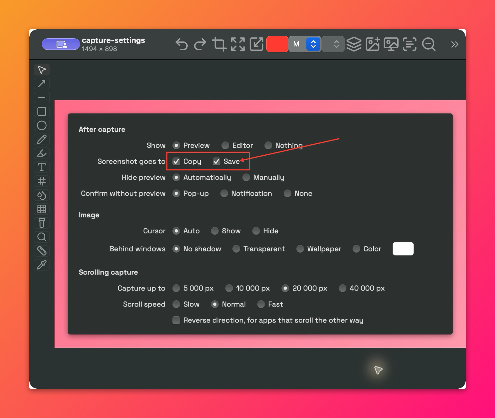
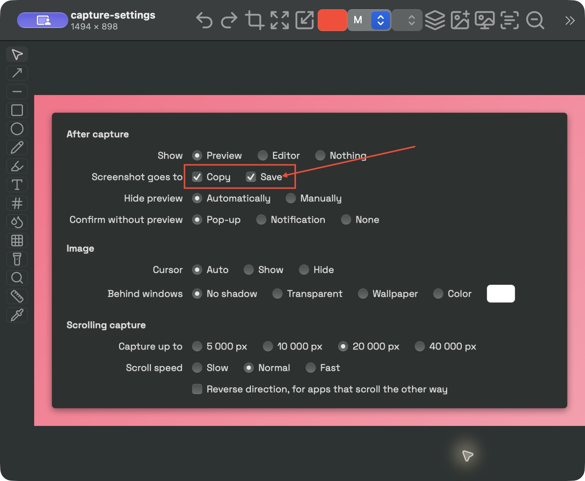
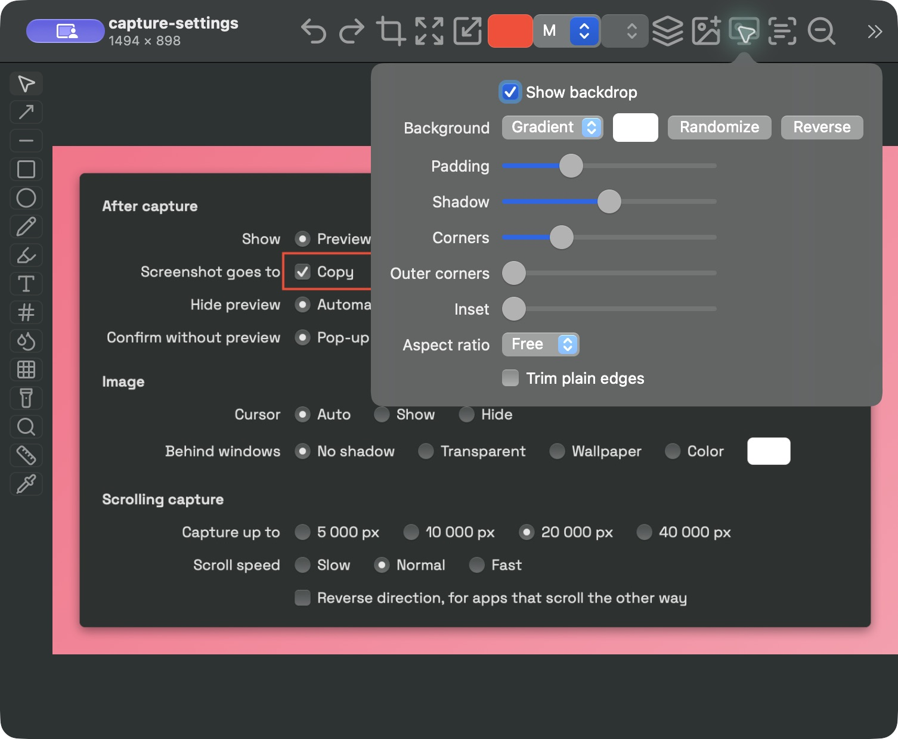
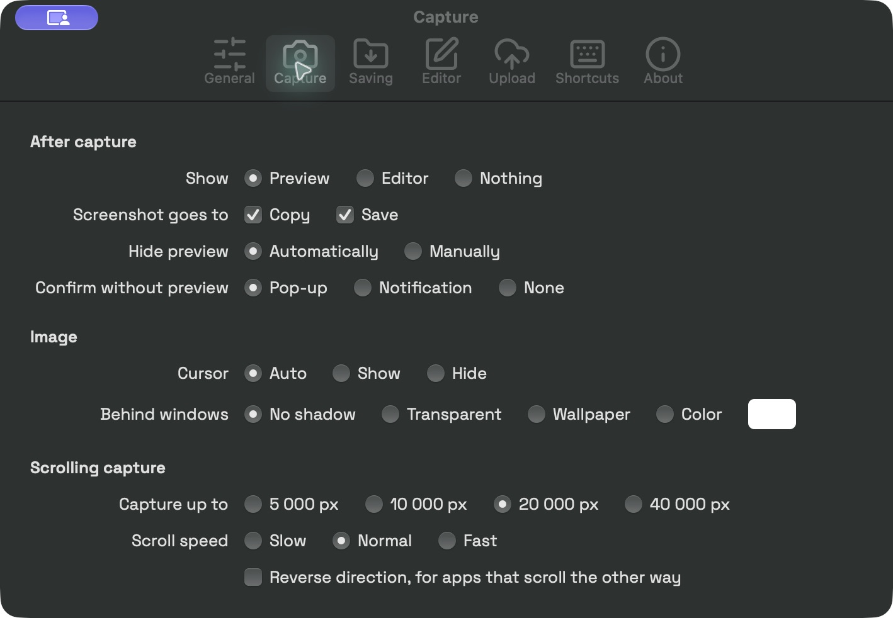
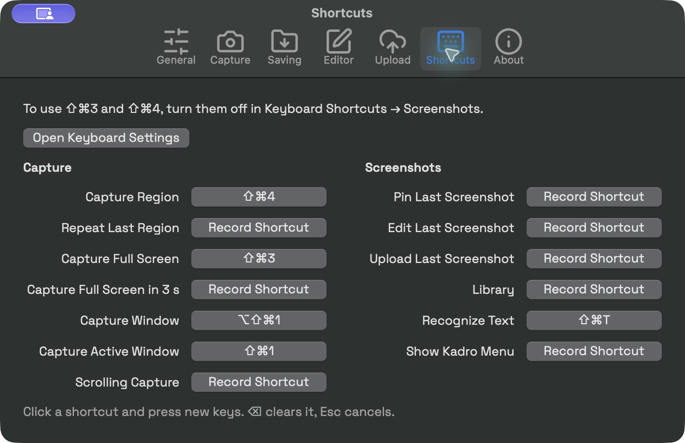

<div align="center">


<h1>Kadro</h1>
<p><b>Capture. Annotate. Make your point.</b></p>
<p>A free, open-source screenshot utility for macOS.<br>
Capture a detail, mark up an idea, copy text, or save a whole scrolling page.</p>
<p>English · <a href="README.ru.md">Русский</a></p>
<p>
<a href="https://github.com/binido/Kadro/releases/latest"></a>


<a href="LICENSE"></a>
</p>
<p>
<a href="https://github.com/binido/Kadro/releases/latest"><b>Download for Mac</b></a> ·
<a href="#install">Install</a> · <a href="#features">Features</a> ·
<a href="docs/guide.md">User guide</a> · <a href="CONTRIBUTING.md">Contribute</a>
</p>

<p><sub>Real Kadro 0.14.0 windows. Annotations and the presentation background were made in Kadro.</sub></p>
</div>

Kadro lives in your menu bar, ready when a screenshot would explain things better.
Built in Rust with AppKit and Apple frameworks, it uses native macOS controls and keeps capture,
editing and text recognition on your Mac. No account is needed to get started.

## Features

| Capture the right thing | Explain it clearly | Keep it useful |
| --- | --- | --- |
| Region, window, full screen, repeat and delayed capture | Arrows, shapes, text, counters and highlighting | Offline text, QR and barcode recognition |
| Scrolling capture, with automatic or manual scrolling | Blur, pixelate, spotlight and magnifier | Searchable screenshot library and floating pins |
| Retina and multiple displays | Crop, resize, measure, pick colours and add a backdrop | Clipboard, PNG/JPEG/HEIC files and optional S3 uploads |

### Mark up without starting over

Add an arrow, frame a detail or hide a distracting area. Annotations stay editable until you
rasterize them, and undo lets you revisit your edits. Use the ruler for pixel measurements,
the colour picker for HEX/RGB/HSL, or Add Capture to combine another region with your image.



### A background, ready to share

Give a screenshot room to breathe with a gradient, mesh gradient, solid colour or blurred-image
background. Adjust padding, shadows, corners and aspect ratio inside the editor.



### Fit your workflow

Choose a preview or the editor after capture, copy and save together, and record your own global
shortcuts. Pin a screenshot above other windows when you need a reference. Find a saved image by
name, date or the text inside it in the Library.

<table>
<tr>
<td width="50%"><br><sub>Choose what happens after a capture.</sub></td>
<td width="50%"><br><sub>Record shortcuts for the actions you use.</sub></td>
</tr>
</table>

See the [full user guide](docs/guide.md) for every tool, setting and `kadro://` automation link.

## Install

**Requires macOS 14 or later. Release downloads are for Apple Silicon (M-series Macs).**
Kadro is under active development; the [roadmap](ROADMAP.md) tracks the path to 1.0.

1. Download the `.dmg` from the [latest release](https://github.com/binido/Kadro/releases/latest).
2. Open it and drag **Kadro** into **Applications**.
3. Open Kadro. Its icon appears in the menu bar.
4. Allow **Screen Recording** in **System Settings → Privacy & Security** when prompted.
   macOS may call this **Screen & System Audio Recording**. Relaunch Kadro if requested.

> [!NOTE]
> Current release builds are signed ad hoc and are not notarized by Apple. macOS may block the
> first launch. If you trust the download from this repository, use **System Settings → Privacy
> & Security → Open Anyway** after attempting to open it. You can also [build from source](#build-from-source).
> [Apple’s instructions](https://support.apple.com/en-us/102445).

Automatic scrolling additionally needs **Accessibility** access; manual scrolling does not.
If a capture shortcut conflicts with macOS, choose another in **Settings → Shortcuts**, or disable
the corresponding system shortcut in **Keyboard → Keyboard Shortcuts → Screenshots**.

### Updates

Kadro can check GitHub for a newer release once a day and open its download page.
Use **More → Check for Updates…** to check manually, or turn the daily check off in Settings.
Updates are downloaded and installed manually.

## Privacy and sharing

Capture, editing and Apple Vision text recognition run locally. Library text indexing also stays
on your Mac. The update check contacts GitHub; it can be disabled.

Uploading is optional and sends the selected screenshot to the S3-compatible storage you configure.
Access keys are stored in macOS Keychain. Choose a temporary link, a public link or no link;
anyone with a usable share link may be able to view the image. **Test Connection** uploads and
deletes a small test file in your bucket.

## Build from source

You need macOS 14+, a current stable Rust toolchain and Xcode Command Line Tools.

```sh
git clone https://github.com/binido/Kadro.git
cd Kadro
./scripts/bundle.sh
```

The app is written to `build/Kadro.app`. Copy it to `/Applications` before enabling launch at login.
The script signs ad hoc unless `KADRO_SIGN_IDENTITY` specifies a signing identity; rebuilding an
ad-hoc app can require granting Screen Recording access again.

For development setup, checks and a source map, see [CONTRIBUTING.md](CONTRIBUTING.md).

## Contributing

Bug reports, documentation, testing and focused pull requests are welcome.
Start with the [contribution guide](CONTRIBUTING.md),
[report a bug](https://github.com/binido/Kadro/issues/new?template=bug_report.yml), or
[suggest an improvement](https://github.com/binido/Kadro/issues/new?template=feature_request.yml).

## License and credits

[MIT](LICENSE) · Built by [binido](https://github.com/binido).

Kadro includes [Space Grotesk](https://github.com/floriankarsten/space-grotesk)
([SIL Open Font License](assets/SpaceGrotesk-OFL.txt)) and [Lucide](https://lucide.dev)
([ISC License](assets/icons/LICENSE)).
