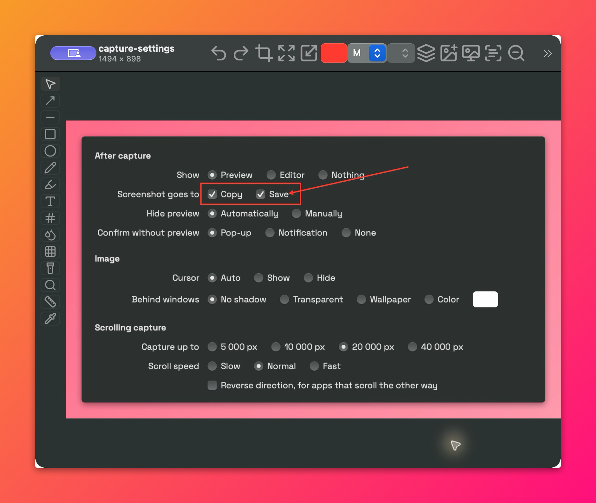
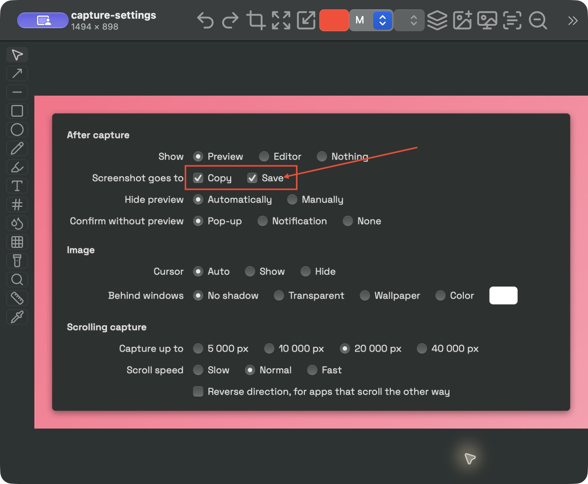
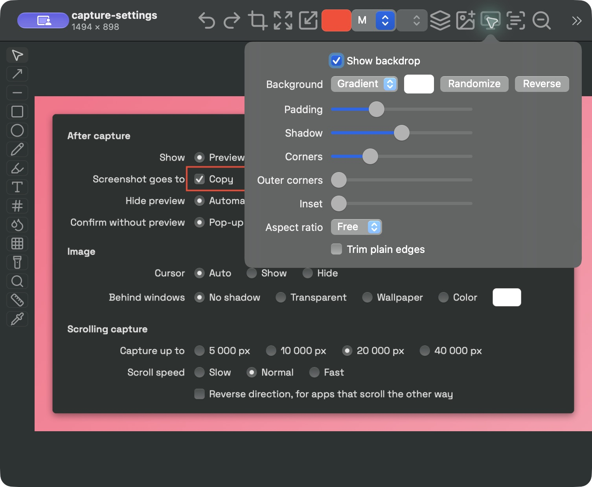
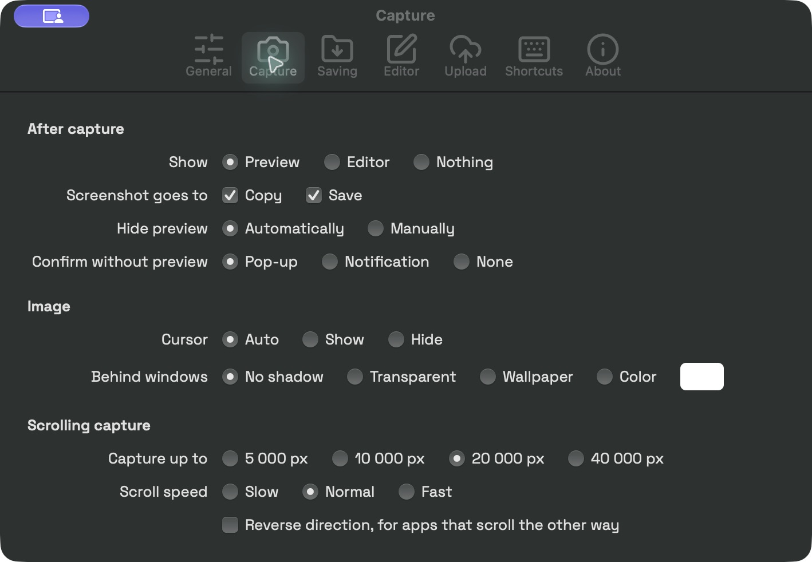
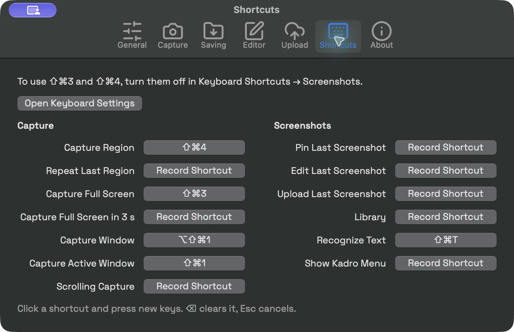

<div align="center">


<h1>Kadro</h1>
<p><b>Снимайте. Отмечайте. Объясняйте.</b></p>
<p>Бесплатная утилита для скриншотов на macOS с открытым исходным кодом.<br>
Снимите нужную деталь, добавьте пояснения, скопируйте текст или сохраните страницу целиком.</p>
<p><a href="README.md">English</a> · Русский</p>
<p>
<a href="https://github.com/binido/Kadro/releases/latest"></a>


<a href="LICENSE"></a>
</p>
<p>
<a href="https://github.com/binido/Kadro/releases/latest"><b>Скачать для Mac</b></a> ·
<a href="#установка">Установка</a> · <a href="#возможности">Возможности</a> ·
<a href="docs/guide.md">Руководство EN</a> · <a href="CONTRIBUTING.md">Участие EN</a>
</p>

<p><sub>Реальные окна Kadro 0.14.0. Аннотации и фон для оформления сделаны в самом Kadro.</sub></p>
</div>

Kadro живёт в строке меню и всегда под рукой, когда проще показать, чем объяснить словами.
Приложение написано на Rust с AppKit и фреймворками Apple, использует родные элементы интерфейса
macOS. Захват, редактирование и распознавание текста работают на вашем Mac. Для начала работы
не нужна учётная запись.

## Возможности

| Снимите нужное | Добавьте пояснения | Используйте результат |
| --- | --- | --- |
| Область, окно, весь экран, повторный захват и таймер | Стрелки, фигуры, текст, нумерация и маркер | Распознавание текста, QR- и штрихкодов без интернета |
| Захват с автоматической или ручной прокруткой | Размытие, пикселизация, подсветка области и лупа | Библиотека с поиском и закреплённые поверх окон снимки |
| Retina и несколько мониторов | Обрезка, размер, измерения, пипетка и фон | Буфер обмена, PNG/JPEG/HEIC и необязательная загрузка в S3 |

### Редактируйте без потери предыдущей работы

Добавьте стрелку, обведите деталь или скройте отвлекающую область. Аннотации остаются редактируемыми
до растеризации, а отмена позволяет вернуться к предыдущим правкам. Линейка измеряет расстояния
в пикселях, пипетка копирует цвет в HEX/RGB/HSL, а Add Capture добавляет на изображение ещё один снимок области.



### Фон для готового снимка

Добавьте отступы и выберите градиент, сеточный градиент, сплошной цвет или размытую копию
изображения. Тени, скругления и соотношение сторон настраиваются прямо в редакторе.



### Настройте под себя

Открывайте превью или редактор после захвата, одновременно копируйте и сохраняйте снимок,
назначайте свои глобальные сочетания клавиш. Закрепите снимок поверх других окон, чтобы держать
его перед глазами. В библиотеке можно найти сохранённое изображение по имени, дате или тексту внутри него.

<table>
<tr>
<td width="50%"><br><sub>Выберите действия после захвата.</sub></td>
<td width="50%"><br><sub>Назначьте сочетания для частых действий.</sub></td>
</tr>
</table>

Все инструменты, настройки и ссылки автоматизации `kadro://` описаны в
[полном руководстве на английском](docs/guide.md).

## Установка

**Нужна macOS 14 или новее. Готовые сборки предназначены для Apple Silicon — Mac с чипами серии M.**
Kadro активно развивается; путь к версии 1.0 описан в [плане развития](ROADMAP.md).

1. Скачайте `.dmg` из [последнего релиза](https://github.com/binido/Kadro/releases/latest).
2. Откройте образ и перетащите **Kadro** в **Программы**.
3. Запустите Kadro. Его значок появится в строке меню.
4. По запросу разрешите **Запись экрана** в **Системных настройках → Конфиденциальность и безопасность**.
   В некоторых версиях macOS раздел называется **Запись экрана и системного аудио**.
   Перезапустите Kadro, если система попросит.

> [!NOTE]
> Текущие релизы подписаны локальной подписью ad hoc и не проходят нотариальное заверение Apple.
> macOS может заблокировать первый запуск. Если вы доверяете сборке из этого репозитория,
> после попытки запуска используйте **Всё равно открыть** в разделе
> **Системные настройки → Конфиденциальность и безопасность**.
> Также можно [собрать приложение из исходников](#сборка-из-исходников).
> [Инструкция Apple](https://support.apple.com/en-us/102445).

Для автоматической прокрутки дополнительно нужен доступ **Универсальный доступ**; для ручной он не требуется.
Если сочетание захвата занято macOS, назначьте другое в **Settings → Shortcuts** или отключите
соответствующее системное сочетание в разделе **Клавиатура → Сочетания клавиш → Снимки экрана**.

### Обновления

Kadro может раз в день проверять новые релизы на GitHub и открывать страницу загрузки.
Для ручной проверки выберите **More → Check for Updates…**. Ежедневную проверку можно отключить
в настройках. Скачивание и установка обновлений выполняются вручную.

## Приватность и обмен снимками

Захват, редактирование и распознавание текста через Apple Vision выполняются локально.
Текстовый индекс библиотеки тоже остаётся на Mac. Проверка обновлений обращается к GitHub;
её можно отключить.

Загрузка необязательна: выбранный снимок отправляется в настроенное вами S3-совместимое хранилище.
Ключи доступа хранятся в Связке ключей macOS. Можно получить временную ссылку, публичную ссылку
или не создавать её. Любой обладатель действующей ссылки может получить доступ к изображению.
Кнопка **Test Connection** загружает и удаляет небольшой тестовый файл в вашем бакете.

## Сборка из исходников

Понадобятся macOS 14+, актуальная стабильная версия Rust и Xcode Command Line Tools.

```sh
git clone https://github.com/binido/Kadro.git
cd Kadro
./scripts/bundle.sh
```

Приложение появится в `build/Kadro.app`. Перед включением автозапуска скопируйте его в `/Applications`.
По умолчанию скрипт использует подпись ad hoc; другую подпись можно задать через `KADRO_SIGN_IDENTITY`.
После пересборки с ad hoc macOS может снова запросить разрешение на запись экрана.

Подготовка окружения, проверки и карта исходников — в [CONTRIBUTING.md](CONTRIBUTING.md), на английском.

## Участие в проекте

Приветствуются сообщения об ошибках, документация, тестирование и небольшие pull request по одной задаче.
Начните с [руководства для участников](CONTRIBUTING.md),
[сообщите об ошибке](https://github.com/binido/Kadro/issues/new?template=bug_report.yml) или
[предложите улучшение](https://github.com/binido/Kadro/issues/new?template=feature_request.yml).

## Лицензия и благодарности

[MIT](LICENSE) · Автор — [binido](https://github.com/binido).

Kadro включает [Space Grotesk](https://github.com/floriankarsten/space-grotesk)
([SIL Open Font License](assets/SpaceGrotesk-OFL.txt)) и иконки [Lucide](https://lucide.dev)
([ISC License](assets/icons/LICENSE)).
